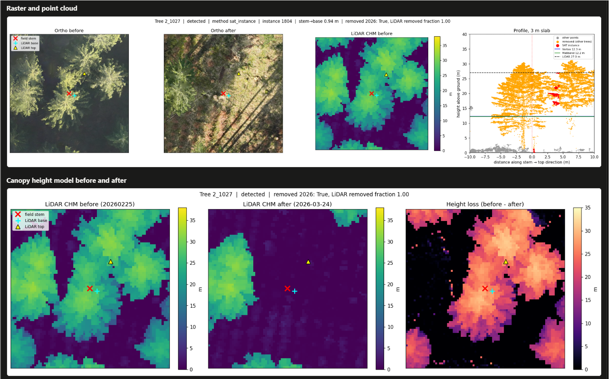

# HALO – Harvest Assessment by LiDAR Observation

HALO compares a terrestrial forest inventory with tree instances segmented from UAV laser scanning (ULS) data acquired before and after a harvest. For every inventoried tree it determines whether a corresponding LiDAR instance exists, how reliable that correspondence is, and how the LiDAR-derived tree height, diameter at breast height (DBH) and stem volume compare with the field measurements. Felled sample trees, whose length was measured with a tape after felling, serve as the height reference; Vertex hypsometer heights are evaluated against the same reference.

The workflow was developed for the trial site Versuch 155 (45 plots) but is driven by a site configuration file and can be applied to other sites with a comparable inventory.



*Example from the dashboard: one felled sample tree with the field stem position (red cross), the base and top of the matched LiDAR instance, orthophotos and canopy height models before and after the harvest, and a 3 m point-cloud slab through the stem.*

## Method overview

1. **Inventory.** Field sheets are read through a column mapping in the site configuration, harmonised to standard names and units, and transformed from local plot coordinates to UTM using surveyed plot corners.
2. **Instances.** Tree instances are taken from SegmentAnyTree segmentations of the pre-harvest point cloud. A post-harvest flight provides the fraction of each instance that has been removed.
3. **Matching.** Field stems are matched to LiDAR instances by stem-base distance under removal constraints. Each match is assigned a detection class (detected, uncertain, not detected) and, where applicable, a cause derived from stand structure (competition, suppression, plot edge).
4. **Stem and DBH.** Stems are searched in a breast-height slice of the normalised point cloud and the DBH is estimated from circle and ellipse fits.
5. **Identity.** A geometry-only score rates whether the matched instance is the same tree as the field record, independent of height and DBH, so that accuracy statistics are not biased by the matching itself.
6. **Comparison.** Height, DBH and stem volume are compared on the matched trees; height accuracy on the sample trees uses the tape length as reference and the Vertex–tape difference as the terrestrial noise floor. Confidence intervals are obtained by bootstrapping.

A raster-based local-maximum detection on the canopy height model is included as a baseline. The individual methods are documented in [docs/METHODS.md](docs/METHODS.md) and [docs/METHODS_identity.md](docs/METHODS_identity.md).

## Repository structure

| Path | Content |
|---|---|
| `core/` | Pipeline stages (inventory, instances, matching, stems and DBH, causes, identity, volume, statistics) and the dashboard export |
| `modules/` | Functions shared with the notebooks: point cloud and raster processing, matching, plotting |
| `scripts/` | Command-line entry points for the pipeline, the statistics and the dashboard |
| `config/` | Site configuration (`site_155.yaml`), its JSON schema and the volume form factors |
| `app/` | Static HTML/JavaScript dashboard |
| `notebooks/` | Processing notebook and a stem-position check against the orthophotos |
| `tests/` | Unit tests and regression tests |
| `docs/` | Method and configuration documentation |

## Installation

Python 3.11 is recommended. PDAL and the geospatial stack are most easily installed from conda-forge:

```bash
conda create -n halo -c conda-forge python=3.11 pdal python-pdal gdal
conda activate halo
pip install -r requirements.txt
```

## Data

Field data, point clouds and rasters are not part of this repository. The configuration refers to them relative to an input data root, written as `${HALO_DATA_ROOT}` in `config/site_155.yaml`. Set the root either as an environment variable

```bash
export HALO_DATA_ROOT=/path/to/data          # PowerShell: $env:HALO_DATA_ROOT = "D:\path\to\data"
```

or write the path into a file `data_root.local` in the project root (excluded from version control). The expected inputs are the inventory sheets with the sample-tree heights, the plot corner coordinates, and SegmentAnyTree-segmented LAZ files of the flights before and after the harvest; see [docs/CONFIG.md](docs/CONFIG.md) for the configuration keys.

## Usage

```bash
python -m core.validate config/site_155.yaml          # check the configuration
python scripts/run_pipeline.py config/site_155.yaml   # all stages; --stage NAME runs one, --force recomputes
python scripts/run_stats.py config/site_155.yaml      # statistics with bootstrap intervals -> stats.json
python scripts/build_dashboard.py config/site_155.yaml
```

Pipeline stages cache their results and are recomputed only when their inputs or the relevant configuration sections change. Results are written to the `output_dir` given in the configuration.

Matches can be corrected without overwriting the automatic result: a row in `match_overrides.csv` (`tree_id,instance`, instance `0` for no LiDAR tree) assigns a different instance, and a manually segmented tree saved as `manual_trees/tree_<plot>_<nr>.laz` replaces the instance. Corrections are kept as separate tiers in the output tables.

### Dashboard

`scripts/build_dashboard.py` writes a self-contained static site to `dist/<site_id>/` (HTML, JavaScript, data file, Plotly and the sample-tree figures). It needs no server and opens directly in a browser. It covers detection, height and DBH accuracy, the identity classes, wood volume and a per-tree view of the sample trees with a 2D and 3D point view.

### Notebooks

`notebooks/01_pipeline_155.ipynb` runs the processing interactively and writes the QA figures per tree. `notebooks/field_stem_position_check.ipynb` overlays the field stem positions of the sample trees on the orthophotos and exports them for GIS. Notebooks are stored without outputs; to keep it that way, register the clean filter once per clone:

```bash
git config filter.strip-output.clean "python scripts/strip_notebook_output.py"
git config filter.strip-output.smudge cat
```

## Tests

```bash
python -m pytest
```

Unit tests run without data. Regression tests compare the pipeline output with reference tables of the study site and are skipped when those are not available.
